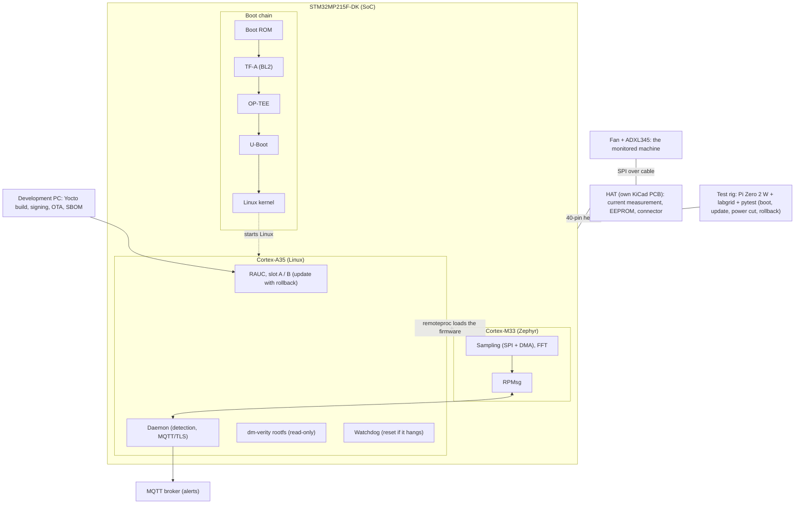

# Architecture: current state

This file describes the CURRENT state of the whole system, not the plan. The plan is in
[plan.md](plan.md). Update this file whenever something in the system changes (a component is built,
a decision is made, a measurement is taken), and keep the "Status" column honest.

Last updated: 2026-11-11.

## Summary

Nothing is built or booted yet. The hardware from the Mouser order has arrived and the board has been
inspected. The project is at the start of phase 1 (bring-up and own image).

Status legend: `planned` (not started), `in progress`, `working` (proof recorded in `captures/`),
`blocked`.

## Target architecture (what we are building)

One board, one HAT, one test rig. The M33 analyzes vibration, Linux is updated securely.

Every boot stage verifies the signature of the next one. Linux loads the M33 firmware (remoteproc) and
talks to it over RPMsg.

## Components and status

| Component | Role | Status |
|---|---|---|
| STM32MP215F-DK | The board of the project | hardware received 2026-11-11, not booted yet |
| Boot chain (Boot ROM, TF-A, OP-TEE, U-Boot) | Signed boot | planned (phase 1, 4) |
| Yocto / OpenSTLinux image (`yocto/`) | The Linux system for the A35 | planned (phase 1) |
| Zephyr firmware for the M33 (`firmware/`) | Sampling, FFT, RPMsg | planned (phase 3) |
| remoteproc + RPMsg link | M33 <-> Linux communication | planned (phase 3), unverified on this board |
| Detection daemon | Statistical anomaly detection, MQTT/TLS alerts | planned (phase 7) |
| RAUC A/B update system | Updates with rollback, dm-verity, watchdog | planned (phase 5) |
| HAT (KiCad PCB) | Current measurement, EEPROM, LED, button, sensor connector | planned (phase 2, bring-up phase 7), not designed yet |
| Test rig (Pi Zero 2 W, labgrid, pytest, relay, USB-UART, Pico) | Automatic verification on the real board | planned (phase 6) |
| Sensor: ADXL345 on a breakout | Vibration measurement | chosen, not yet connected |
| 5 V fan | The "machine" being monitored | bought, not yet used |

## Hardware inventory (what exists today)

Received from the Mouser order (2026-11-11):
- STM32MP215F-DK (511-STM32MP215F-DK).
- SEN0032: DFRobot ADXL345 triple-axis accelerometer breakout (I2C and SPI).
- DFR0251: DFRobot Gravity digital 16 A relay module, 1 channel, 5 V DC supply. Its DC contact rating
  must be checked before phase 6.
- FIT0121: DFRobot jumper wires, female/male, 65 pack.
- FIT0030: NOT identified yet. Read the bag label.
  (Identified by part number from distributor listings: TME, Digi-Key, Jameco, DFRobot wiki.)

Already owned: Raspberry Pi Zero 2 W, Raspberry Pi Pico (logic analyzer), USB-UART, 2 microSD 32 GB,
passives and cables, Nucleo-F411RE (not used in this project).
Note: ST verified only SanDisk Class 10 / UHS-1 microSD cards for this board. The card for the board
is a SanDisk, marked Class 10 and A1.

Tools (soldering iron, solder, cutter, multimeter): ordered from Skroutz; delivery state not recorded here yet.

## Board facts: STM32MP215F-DK

Platform: 1x Cortex-A35 at 1.5 GHz, Cortex-M33 at 300 MHz, 2 GB LPDDR4, no NPU, no eMMC, 100 Mbit
Ethernet, USB-C power, M.2 E-Key slot, 40-pin GPIO expansion header.

Observed on the physical board (photos taken 2026-11-11) and in ST documentation:

| Item | Fact | Source |
|---|---|---|
| Boot storage | microSD slot, silkscreen "SD CARD", reference CN7, 8 contacts. A microSD card (11 mm wide) is smaller than the socket shell; this is normal | photo, ST hardware description wiki |
| Boot mode switches | Two DIP switch blocks: SW1 (BOOT3, BOOT2) and SW2 (BOOT1, BOOT0). The position for "boot from microSD" is NOT recorded yet | photo; positions to be taken from the board manual (UM3571) |
| STLINK | Debug connector, reference CN5, silkscreen "STLINK" | photo, ST wiki. Exact connector type (pins, pitch) not verified |
| Display | FFC connector CN8, silkscreen "DISPLAY" | photo, ST wiki |
| Ethernet | RJ45, reference CN11 | photo |
| GPIO expansion | 40-pin header CN12 | ST wiki. Pinout compared to Raspberry Pi NOT verified |
| Cortex-A35 console | VCPA35, reference CN2 | ST wiki |
| Power | Power cable connector CN10 | ST wiki |
| Flashing | USB connector CN15 (USB_DRD) is used for flashing (boot from UART/USB switch position) | ST wiki |

## Interfaces (planned)

| Link | Between | Notes |
|---|---|---|
| SPI + DMA | ADXL345 <-> M33 | via the 40-pin header / HAT cable, fixed sample rate. Pin mapping not defined yet (see unverified items) |
| RPMsg over remoteproc | M33 <-> A35 | the A35 loads the M33 firmware and receives the FFT spectrum |
| MQTT over TLS | A35 -> MQTT broker | alerts when the spectrum deviates from the learned healthy spectrum |
| 40-pin header | board <-> HAT | HAT: current-measurement chip (INA219-type), EEPROM, LED, button, sensor connector |
| Power + console | rig <-> board | relay on the 5 V DC line only (never mains), USB-UART console |
| Logic analyzer | Pico <-> SPI lines | verifies equal sample spacing and measures jitter |

## Open items and unverified facts

1. Secure boot flow on the MP21 (TF-A, OP-TEE, signed FIT): not verified. Required before phase 4.
2. CN12 40-pin pinout compared to Raspberry Pi: not verified. Required before the HAT PCB order
   (end of week 4).
3. CN5 connector type (STLINK header): reference and silkscreen known, exact type not verified.
4. RPMsg from Zephyr on this board: not verified. Test on the first day of phase 3.
5. Boot switch positions for microSD boot: to be confirmed from UM3571 before the first power-up.
6. Mouser part FIT0030 is not identified. The 5 V fan is not among the identified parts: confirm
   whether FIT0030 is the fan or the fan comes from the Skroutz order.
7. microSD: resolved. SanDisk, Class 10, A1.

## Decisions

No ADRs yet. They go in [decisions/](decisions/) using `decisions/adr-template.md`.
Decisions expected: accelerometer choice (phase 2), boot chain options (phase 1/4),
fuses and secure boot lock (end of week 7).
