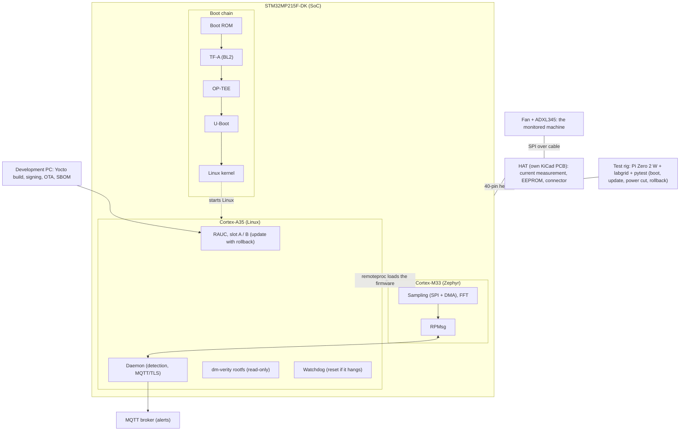

# Architecture: current state

This file describes the CURRENT state of the whole system, not the plan. The plan is in
[plan.md](plan.md). Update this file whenever something in the system changes (a component is built,
a decision is made, a measurement is taken), and keep the "Status" column honest.

Last updated: 2026-11-13.

## Summary

Phase 1 (bring-up and own image) is in progress. The board boots ST's ready-made image (Starter
Package) from microSD, and the A35 console works. Nothing of our own is built yet.

Status legend: `planned` (not started), `in progress`, `working` (proof recorded in `captures/`),
`blocked`.

## Target architecture (what we are building)

One board, one HAT, one test rig. The M33 analyzes vibration, Linux is updated securely.

Every boot stage verifies the signature of the next one. Linux loads the M33 firmware (remoteproc) and
talks to it over RPMsg.

## Components and status

| Component | Role | Status |
|---|---|---|
| STM32MP215F-DK | The board of the project | working: boots from microSD (2026-11-13). In USB/UART programming mode (switches 0000) LD5 blinks at about 3-4 Hz (Boot ROM waiting, PH4) |
| Boot chain (Boot ROM, TF-A, OP-TEE, U-Boot) | Signed boot | ST's binaries boot (TF-A v2.10, OP-TEE 4.0, U-Boot 2023.10, Linux 6.6), see `captures/first_boot.log`. Not signed yet (phase 4) |
| Yocto / OpenSTLinux image (`yocto/`) | The Linux system for the A35 | in progress: ST Starter Package OpenSTLinux v26.06.10 (A35-TD, flash layout `FlashLayout_sdcard_stm32mp215f-dk-ca35tdcid-ostl-optee.tsv`) boots; own image not built yet |
| Zephyr firmware for the M33 (`firmware/`) | Sampling, FFT, RPMsg | planned (phase 3) |
| remoteproc + RPMsg link | M33 <-> Linux communication | planned (phase 3), unverified on this board |
| Detection daemon | Statistical anomaly detection, MQTT/TLS alerts | planned (phase 7) |
| RAUC A/B update system | Updates with rollback, dm-verity, watchdog | planned (phase 5) |
| HAT (KiCad PCB) | Current measurement, EEPROM, LED, button, sensor connector | planned (phase 2, bring-up phase 7), not designed yet |
| Test rig (Pi Zero 2 W, labgrid, pytest, relay, USB-UART, Pico) | Automatic verification on the real board | planned (phase 6) |
| Sensor: ADXL345 on a breakout | Vibration measurement | chosen, not yet connected |
| 5 V fan | The "machine" being monitored | ordered, expected by 2026-11-16 |

## Hardware inventory (what exists today)

Received from the Mouser order (2026-11-11):
- STM32MP215F-DK (511-STM32MP215F-DK).
- SEN0032: DFRobot ADXL345 triple-axis accelerometer breakout (I2C and SPI).
- DFR0251: DFRobot Gravity digital 16 A relay module, 1 channel, 5 V DC supply. Its DC contact rating
  must be checked before phase 6.
- FIT0121: DFRobot jumper wires, female/male, 65 pack.
- FIT0030: wires.
  (Identified by part number from distributor listings: TME, Digi-Key, Jameco, DFRobot wiki.)

Already owned: Raspberry Pi Zero 2 W, Raspberry Pi Pico (logic analyzer), USB-UART adapter (used for
the board's serial console), microSD card reader, power supply for the board (Samsung USB-C charger, 15 W, 5 V / 3 A;
a new USB-C to USB-C cable still to be bought), 2 microSD 32 GB,
passives and cables, Nucleo-F411RE (not used in this project).
Note: ST verified only SanDisk Class 10 / UHS-1 microSD cards for this board. The card for the board
is a SanDisk, marked Class 10 and A1.

Received 2026-11-13: soldering iron, solder wire, multimeter.
Ordered, expected by 2026-11-16: side cutter, 5 V fan.

## Board facts: STM32MP215F-DK

Platform: 1x Cortex-A35 at 1.5 GHz, Cortex-M33 at 300 MHz, 2 GB LPDDR4, no NPU, no eMMC, 100 Mbit
Ethernet, USB-C power, M.2 E-Key slot, 40-pin GPIO expansion header.

Observed on the physical board (photos taken 2026-11-11) and in ST documentation:

| Item | Fact | Source |
|---|---|---|
| Boot storage | microSD slot, silkscreen "SD CARD", reference CN7, 8 contacts. A microSD card (11 mm wide) is smaller than the socket shell; this is normal | photo, ST hardware description wiki |
| Boot mode switches | SW2 = BOOT0, BOOT1; SW1 = BOOT2, BOOT3. ON = 1 (pin tied to VDDIO through 1 kOhm). microSD boot (A35): BOOT0 ON, others OFF (0b0001). All OFF (0b0000) = UART/USB flash programming. Read only at reset. Valid with the default boot OTP (0b00). Current position: all OFF | UM3571 Rev 1, p. 13, Tables 4-5; schematic B-02, sheet 14; DS14556 Rev 2, p. 14, Table 5 |
| STLINK | CN5: STDC14 debug connector, 14 pins in 2 rows of 7. Carries SWD/JTAG and the A35 console (USART2). Pitch about half of CN12's (by eye), consistent with STDC14 | UM3571 Rev 1, p. 2; MB2059 schematic B-02, sheet 3; counted on the board |
| Display | FFC connector CN8, silkscreen "DISPLAY" | photo, ST wiki |
| Ethernet | RJ45, reference CN11 | photo |
| GPIO expansion | 40-pin header CN12: 3V3 on pins 1, 17; 5V on pins 2, 4; SPI1 on pins 19 (MOSI, PI5), 21 (MISO, PD1), 23 (SCK, PD11), 24 (NSS, PD2). I/O at 3.3 V (VDDIO). Errata in UM3571: pin 16 (SDMMC3.CMD) is PD12, not PH8 (PH8 is the M33 console RX on CN1). Comparison with Raspberry Pi: see open items | UM3571 Rev 1, p. 26, Table 17; schematic B-02, sheet 3 |
| Consoles | CN2 "VCPA35": Cortex-A35 console, USART2 (PA4 TX, PA8 RX). CN1 "VCPM33": Cortex-M33 console, UART4 (PH7 TX, PH8 RX). 3-pin headers, pin 1 = board RX, pin 2 = GND, pin 3 = board TX. A35 console: 115200 baud, Linux device ttySTM0 | UM3571 Rev 1, p. 9, p. 28, p. 30; schematic sheet 3; `captures/first_boot.log` line 207 |
| Silicon revision | The chip reports Rev.Z (UM3571 lists revision "Y"). ES0628 errata must be read for Rev.Z | `captures/first_boot.log` lines 1, 91; UM3571 Rev 1, p. 33 |
| Power | Power cable connector CN10 | ST wiki |
| Flashing | USB connector CN15 (USB_DRD) is used for flashing (boot from UART/USB switch position) | ST wiki |

## Interfaces (planned)

| Link | Between | Notes |
|---|---|---|
| SPI + DMA | ADXL345 <-> M33 | via the 40-pin header / HAT cable, fixed sample rate. Pin mapping not defined yet (see unverified items) |
| RPMsg over remoteproc | M33 <-> A35 | the A35 loads the M33 firmware and receives the FFT spectrum |
| MQTT over TLS | A35 -> MQTT broker | alerts when the spectrum deviates from the learned healthy spectrum |
| 40-pin header | board <-> HAT | HAT: current-measurement chip (INA219-type), EEPROM, LED, button, sensor connector |
| Power + console | rig <-> board | relay on the 5 V DC line only (never mains), USB-UART console |
| Logic analyzer | Pico <-> SPI lines | verifies equal sample spacing and measures jitter |

## Open items and unverified facts

1. Secure boot flow on the MP21 (TF-A, OP-TEE, signed FIT): not verified. Required before phase 4.
2. CN12 40-pin pinout compared to Raspberry Pi: not verified. Required before the HAT PCB order
   (end of week 4).
3. RPMsg from Zephyr on this board: not verified. Test on the first day of phase 3.

## Decisions

No ADRs yet. They go in [decisions/](decisions/) using `decisions/adr-template.md`.
Decisions expected: accelerometer choice (phase 2), boot chain options (phase 1/4),
fuses and secure boot lock (end of week 7).
