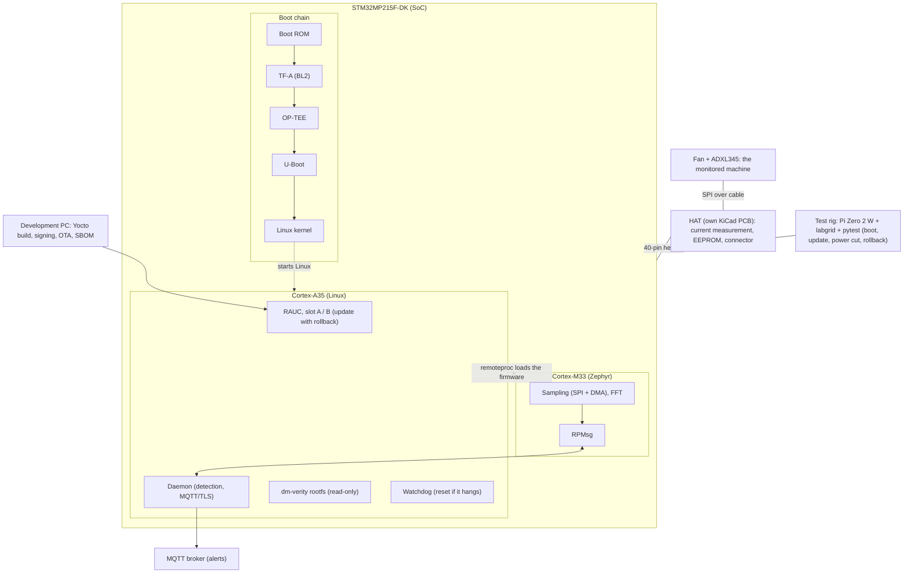

# Architecture: current state

This file describes the CURRENT state of the whole system, not the plan. The plan, with the phases and
their progress, is in [plan.md](plan.md). The file is organized by part of the system: when a phase
changes a part, that part's section is updated to describe it as it is now (the history stays in
git). Update this file whenever something in the system changes (a part is built, a decision is made,
a measurement is taken), and keep the "Status" column honest.

Last updated: 2026-11-18.

## Summary

Phase 1 (bring-up and own image) is in its final steps. The board boots my own Linux image,
`vibration-image`, from microSD in 15.0 s from TF-A to login: ST's boot chain (TF-A, OP-TEE, U-Boot,
not signed yet) and ST's Linux 6.6, trimmed to what the product needs. It is reached over SSH on
Ethernet and over the serial console on CN2, and runs my first program, `vibration-hello`. The rest
of the target system (M33 firmware, HAT, secure boot, updates, test rig, detection) is planned.

## Target architecture (what I am building)

One board, one HAT, one test rig. The M33 analyzes vibration, Linux is updated securely.

Every boot stage verifies the signature of the next one. Linux loads the M33 firmware (remoteproc) and
talks to it over RPMsg.

How the parts connect (planned):

| Link | Between | Phase | Notes |
|---|---|---|---|
| SPI + DMA | ADXL345 <-> M33 | 3 | via the 40-pin header / HAT cable, fixed sample rate. Pin mapping not defined yet (see open items) |
| RPMsg over remoteproc | M33 <-> A35 | 3 | the A35 loads the M33 firmware and receives the FFT spectrum |
| Logic analyzer | Pico <-> SPI lines | 3 | verifies equal sample spacing and measures jitter |
| Power + console | test rig <-> board | 6 | relay on the 5 V DC line only (never mains), USB-UART console |
| 40-pin header | board <-> HAT | 2, 7 | HAT: current-measurement chip (INA219-type), EEPROM, LED, button, sensor connector |
| MQTT over TLS | A35 -> MQTT broker | 7 | alerts when the spectrum deviates from the learned healthy spectrum |

## System parts and status

| Part | Role | Phase | Status |
|---|---|---|---|
| STM32MP215F-DK | the board of the project | 1 | working: boots my image from microSD |
| Boot chain (Boot ROM, TF-A, OP-TEE, U-Boot) | starts Linux; later verifies every stage | 1, 4 | working: ST's binaries (TF-A v2.10, OP-TEE 4.0, U-Boot 2023.10). Not signed (phase 4) |
| Linux image `vibration-image` (layer `meta-vibration-node`) | the Linux system on the A35 | 1 | working: boots in 15.0 s, see Linux image |
| ADXL345 on a breakout | vibration sensor | 2, 3 | header soldered, continuity checked, not connected |
| HAT (KiCad PCB) | current measurement, EEPROM, LED, button, sensor connector | 2, 7 | planned, not designed |
| Zephyr firmware for the M33 (`firmware/`) | sampling, FFT, RPMsg | 3 | planned |
| remoteproc + RPMsg | M33 <-> Linux communication | 3 | planned, unverified on this board |
| 5 V fan | the "machine" being monitored | 3, 7 | received, not used |
| RAUC A/B updates, dm-verity, watchdog | updates with rollback, read-only rootfs | 5 | planned |
| Test rig (Pi Zero 2 W, labgrid, pytest, relay, USB-UART, Pico) | automatic verification on the real board | 6 | planned |
| Detection daemon | statistical anomaly detection, MQTT/TLS alerts | 7 | planned |

Status legend: `planned` (not started), `in progress`, `working` (proof recorded in `captures/`),
`blocked`.

## Linux image (A35)

`vibration-image`, built with Yocto from ST's OpenSTLinux v26.06.10 layers (Yocto 5.0.17) and my
layer `meta-vibration-node` (`yocto/layers/meta-vibration-node/`). MACHINE `stm32mp21-disco`, DISTRO
`openstlinux-weston`, ST's Linux 6.6.129, device tree `stm32mp215f-dk`.

### Contents

- `inherit core-image` with its default package list replaced: `packagegroup-core-boot` plus
  `packagegroup-optee-core`, `vibration-hello`, `e2fsprogs-e2fsck`, `kmod`, and the
  `ssh-server-dropbear` feature. `packagegroup-base-extended` (audio, Bluetooth, Wi-Fi, mDNS) is not
  installed.
- 826 packages, rootfs filesystem 112.7 MB with 22 MB free. No package manager on the board (no
  `package-management` feature).
- `PACKAGE_EXCLUDE`: `busybox-syslog` (the journal already collects the logs) and ST's example
  firmware `m33projects-stm32mp2`, `m0projects-stm32mp2` (recommended by the machine features
  `m33copro`/`m0copro`). `BAD_RECOMMENDATIONS` does not work with `.deb` packages.
- Masked systemd units (linked to `/dev/null`): `getty@tty1` (no screen) and `systemd-boot-update`
  (no EFI boot).
- Hostname `vibration-node`, set at build time in `base-files` (ST's `st-hostname` service raced with
  the Ethernet driver once the initrd was gone, see ADR-0001).

### Boot settings

- U-Boot: `CONFIG_BOOTDELAY=0` (config fragment) and a single extlinux entry without splash, so no
  boot menu and no wait.
- No initrd: no `INITRD` line in `extlinux.conf`, `st-initrd` not installed. The kernel mounts the
  rootfs itself (ADR-0001). The filesystems are not grown on the first boot.

### Kernel and device tree

- Kernel configuration fragment `fragment-vibration-drop.cfg`: camera, display, touchscreen,
  backlight, framebuffer, audio, Wi-Fi, Bluetooth, USB and its charger detection, debug tracing, UIO,
  PCI, network filesystems, virtualization, huge pages, other vendors' SD controllers, quotas and
  JFFS2 switched off (ADR-0002). 17 modules loaded at boot (70 before), 1702 built-in options (2065).
- Device tree patch `0001-stm32mp215f-dk-disable-unused-hardware.patch`: the nodes for that hardware
  are `disabled`, I2C2 included (ADR-0003).

### Partition layout

On the SD card (`.tsv`, sizes set in the image recipe):

| Partition | Size | Content |
|---|---|---|
| fsbla1/2, metadata1/2, fip-a/b, u-boot-env | about 9.5 MB | TF-A, firmware update metadata, OP-TEE + U-Boot (FIP), U-Boot environment |
| bootfs | 64 MB | kernel `Image.gz` (8.5 MB), device tree, `extlinux.conf` |
| vendorfs | 32 MB (ST: 250 MB) | empty |
| rootfs | 512 MB (ST: 4 GB) | the root filesystem, 112.7 MB |
| userfs | the rest of the 768 MB `.raw`, about 150 MB | empty |

### Boot time

TF-A to login (`tools/boot_time.py`, normal boots, logs in `captures/`):

| Stage | ST Starter Package | st-image-weston rebuilt | vibration-image | vibration-image trimmed |
|---|---|---|---|---|
| TF-A BL2 | 0.60 s | 0.62 s | 0.59 s | 0.59 s |
| BL31 + OP-TEE | 0.77 s | 0.84 s | 0.83 s | 0.83 s |
| U-Boot | 5.54 s | 5.55 s | 5.52 s | 1.97 s |
| Kernel | 2.74 s | 3.00 s | 3.02 s | 2.03 s |
| initrd + rootfs (trimmed: no initrd) | 6.39 s | 6.77 s | 6.77 s | 0.79 s |
| systemd to login | 21.4 s | 21.4 s | 12.2 s | 8.78 s |
| **Total** | **37.5 s** | **38.2 s** | **29.0 s** | **15.0 s** |

The reference columns: ST's prebuilt Starter Package image (MACHINE `stm32mp2`, device tree
`ca35tdcid-ostl`), and ST's `st-image-weston` rebuilt from source in my build directory.

First boots: 58.6 s (st-image-weston rebuilt), 51.4 s (vibration-image, the initrd grew the
filesystems once), 15.4 s (trimmed). The trimming steps, each measured on the board: U-Boot delay
and menu plus `packagegroup-base` 29.0 to 25.2 s, no initrd 25.2 to 18.0 s, kernel drivers (three
steps) 18.0 to 16.0 s, device tree 16.0 to 15.2 s, systemd services 15.2 to 15.0 s.

With `quiet` on the kernel command line, the trimmed image boots in 13.2 s (2.0 s less: the serial
console at 115200 baud no longer prints about 500 lines). Kept verbose during development; planned
for the product build as a change of the extlinux `APPEND` line.

### Workarounds for ST's classes

In the image recipe, for ST's partition class (`image_types-stsplitpartitions`):
- `IMAGE_ROOTFS_EXTRA_SPACE = "8192"`: ST sizes each filesystem as content x 1.3 with no minimum, so
  a small userfs did not fit ext4's journal ("Could not allocate block").
- `export splitted_directory`: ST's class runs `du` on this unset variable, which scans the whole
  build directory (44 min instead of 32 s). The result is overwritten anyway.
- The partition sizes must use ST's exact variable names, `${...}` included: with the label written
  out, ST's name expands to the same key at the end of parsing and replaces mine.

## Hardware

### Inventory (what exists today)

Received from the Mouser order (2026-11-11):
- STM32MP215F-DK (511-STM32MP215F-DK).
- SEN0032: DFRobot ADXL345 triple-axis accelerometer breakout (I2C and SPI).
- DFR0251: DFRobot Gravity digital 16 A relay module, 1 channel, 5 V DC supply. Its DC contact rating
  must be checked before phase 6.
- FIT0121: DFRobot jumper wires, female/male, 65 pack.
- FIT0030: wires.
  (Identified by part number from distributor listings: TME, Digi-Key, Jameco, DFRobot wiki.)

Already owned: Raspberry Pi Zero 2 W, Raspberry Pi Pico (logic analyzer), USB-UART adapter (used for
the board's serial console), microSD card reader, power supply for the board (Samsung USB-C charger, 15 W, 5 V / 3 A,
with a USB-C to USB-C cable), 2 microSD 32 GB,
passives and cables, Nucleo-F411RE (not used in this project).
Note: ST verified only SanDisk Class 10 / UHS-1 microSD cards for this board. The card for the board
is a SanDisk, marked Class 10 and A1.

Received: soldering iron, solder wire, multimeter (2026-11-13); side cutter, 5 V fan (by 2026-11-15).
All ordered items have arrived.

### Board facts: STM32MP215F-DK

Platform: 1x Cortex-A35 at 1.5 GHz, Cortex-M33 at 300 MHz, 2 GB LPDDR4, no NPU, no eMMC, 100 Mbit
Ethernet, USB-C power, M.2 E-Key slot, 40-pin GPIO expansion header.

Observed on the physical board (photos taken 2026-11-11) and in ST documentation:

| Item | Fact | Source |
|---|---|---|
| Boot storage | microSD slot, silkscreen "SD CARD", reference CN7, 8 contacts. A microSD card (11 mm wide) is smaller than the socket shell; this is normal | photo, ST hardware description wiki |
| microSD interface | SDMMC1, 4 data bits, High Speed mode at 50 MHz and 3.3 V (about 25 MB/s at most). UHS-I is not supported, so this is the board's maximum. Measured on the board: `/sys/kernel/debug/mmc0/ios` shows `clock: 50000000 Hz`, `timing spec: sd high-speed` | UM3571 Rev 1, p. 17, section 8.2.2 |
| Boot mode switches | SW2 = BOOT0, BOOT1; SW1 = BOOT2, BOOT3. ON = 1 (pin tied to VDDIO through 1 kOhm). microSD boot (A35): BOOT0 ON, others OFF (0b0001). All OFF (0b0000) = UART/USB flash programming. Read only at reset. Valid with the default boot OTP (0b00). Current position: 0b0001 (microSD boot) | UM3571 Rev 1, p. 13, Tables 4-5; schematic B-02, sheet 14; DS14556 Rev 2, p. 14, Table 5 |
| Programming mode | With the switches at 0b0000, LD5 blinks at about 3-4 Hz (Boot ROM waiting, PH4) | observed on the board (2026-11-13) |
| STLINK | CN5: STDC14 debug connector, 14 pins in 2 rows of 7. Carries SWD/JTAG and the A35 console (USART2). Pitch about half of CN12's (by eye), consistent with STDC14 | UM3571 Rev 1, p. 2; MB2059 schematic B-02, sheet 3; counted on the board |
| Display | FFC connector CN8, silkscreen "DISPLAY" | photo, ST wiki |
| Ethernet | RJ45, reference CN11 | photo |
| GPIO expansion | 40-pin header CN12: 3V3 on pins 1, 17; 5V on pins 2, 4; SPI1 on pins 19 (MOSI, PI5), 21 (MISO, PD1), 23 (SCK, PD11), 24 (NSS, PD2). I/O at 3.3 V (VDDIO). Errata in UM3571: pin 16 (SDMMC3.CMD) is PD12, not PH8 (PH8 is the M33 console RX on CN1). Comparison with Raspberry Pi: see open items | UM3571 Rev 1, p. 26, Table 17; schematic B-02, sheet 3 |
| Consoles | CN2 "VCPA35": Cortex-A35 console, USART2 (PA4 TX, PA8 RX). CN1 "VCPM33": Cortex-M33 console, UART4 (PH7 TX, PH8 RX). 3-pin headers, pin 1 = board RX, pin 2 = GND, pin 3 = board TX. A35 console: 115200 baud, Linux device ttySTM0 | UM3571 Rev 1, p. 9, p. 28, p. 30; schematic sheet 3; `captures/st-starter_first-boot_untimed.log` line 207 |
| Silicon revision | The chip reports Rev.Z (UM3571 lists revision "Y"). ES0628 errata must be read for Rev.Z | `captures/st-starter_first-boot_untimed.log` lines 1, 91; UM3571 Rev 1, p. 33 |
| Power and USB | CN10 is the only USB connector: USB Type-C, 5 V power input and USB 2.0 data (device). Its CC1/CC2 lines go to ADC inputs ANA0/ANA1 to detect the current the power source offers (0.5, 1.5 or 3 A). Also used for flashing with STM32CubeProgrammer (UART/USB boot switch position). Checked on the board | UM3571 Rev 1, p. 11, section 7.4.2; p. 16, section 8.1 |

## Open items and unverified facts

1. Secure boot flow on the MP21 (TF-A, OP-TEE, signed FIT): not verified. Required before phase 4.
2. CN12 40-pin pinout compared to Raspberry Pi: not verified. Required before the HAT PCB order
   (end of week 4).
3. RPMsg from Zephyr on this board: not verified. Test on the first day of phase 3.
4. Bus for the HAT's current sensor and EEPROM: no I2C bus reaches CN12. Pins 3 and 5 carry I3C1
   (PA2, PG13), pins 27 and 28 I3C2 (UM3571 Rev 1, p. 26, Table 17), and I2C2 only goes to the
   camera connector and the touch panel (p. 21, Table 12). To check in DS14556 before the HAT design
   (phase 2): I2C as an alternate function of these pins, or I3C driving I2C devices.
5. Every small systemd job takes 0.3-0.8 s during boot (even mounting a tmpfs), so systemd still takes
   8.8 s. Not verified why; reading programs from the SD card (50 MHz, the board's maximum) is
   suspected.
6. ST's `stm32mp-calibration.timer` recalibrates the internal oscillators HSI/CSI every few seconds.
   What depends on these oscillators on this board is not checked (RM0506).
7. `stm32_lptimer` is kept: whether the built-in clock driver `CLKSRC_STM32_LP` needs it is not
   verified.
8. Every boot logs `stm32-rproc 0.m33: ... could not locate channel named "detach"`. To look at with
   remoteproc in phase 3.

## Decisions

ADRs in [decisions/](decisions/), using `decisions/adr-template.md`:
- [ADR-0001](decisions/0001-boot-without-initrd.md): boot without an initrd.
- [ADR-0002](decisions/0002-kernel-drivers-keep-drop.md): switch off kernel drivers for hardware the
  node does not use.
- [ADR-0003](decisions/0003-device-tree-disable-unused-hardware.md): disable unused hardware in the
  device tree with a patch.

Decisions expected: accelerometer choice (phase 2), boot chain and signing (phase 4), fuses and
secure boot lock (end of week 7).
