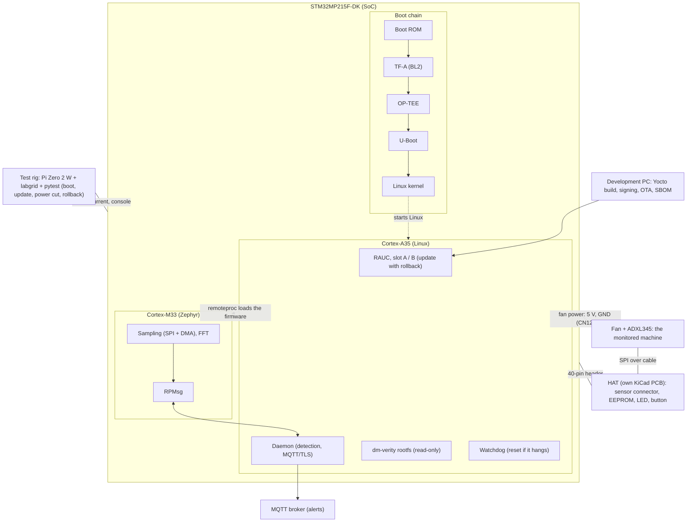

# Architecture: current state

This file describes the CURRENT state of the whole system, not the plan. The plan, with the phases and
their progress, is in [plan.md](plan.md). The file is organized by part of the system: when a phase
changes a part, that part's section is updated to describe it as it is now (the history stays in
git). Update this file whenever something in the system changes (a part is built, a decision is made,
a measurement is taken), and keep the "Status" column honest.

Last updated: 2026-11-26.

## Summary

Phase 1 (bring-up and own image) is done. The board boots my own Linux image,
`vibration-image`, from microSD in 15.0 s from TF-A to login: ST's boot chain (TF-A, OP-TEE, U-Boot,
not signed yet) and ST's Linux 6.6, trimmed to what the product needs. It is reached over SSH on
Ethernet and over the serial console on CN2, and runs my first program, `vibration-hello`. Secure
boot, updates, the test rig and the detection are planned.
Phase 2 (HAT design): the sensor is chosen (ADR-0004), the current measurement moved
to the test rig (ADR-0005), the HAT's pins on CN12 are decided (ADR-0006) and the button is
debounced in hardware (ADR-0007). The KiCad design is finished (ERC and DRC clean), the wire test on CN12
pins 17-30 passed (SPI1 and both interrupt pins work from the M33), and 3 boards are ordered at
Aisler (2026-11-26).
Phase 3 (sampling and FFT on the M33) is in progress: the Zephyr workspace and toolchain are set up,
Linux loads, starts and stops Zephyr firmware on the M33 with remoteproc, and RPMsg works between
Zephyr and Linux (Zephyr's RPMsg sample). My own M33 app, `vibration-m33`, reads the ADXL345's ID
over SPI1 and receives its INT1 and INT2 interrupts, with the breakout wired to CN12 exactly as on
the HAT.

## Target architecture (what I am building)

One board, one HAT, one test rig. The M33 analyzes vibration, Linux is updated securely.

Every boot stage verifies the signature of the next one. Linux loads the M33 firmware (remoteproc) and
talks to it over RPMsg.

How the parts connect (the Phase column says when each link is built):

| Link | Between | Phase | Notes |
|---|---|---|---|
| SPI + DMA | ADXL345 <-> M33 | 3 | via the 40-pin header / HAT cable, fixed sample rate. SPI1 on CN12 pins 19, 21, 23, 24 (see Board facts). SPI and both interrupt pins work on jumper wires; DMA and the fixed-rate sampling not yet (see M33 firmware) |
| RPMsg over remoteproc | M33 <-> A35 | 3 | the A35 loads the M33 firmware and receives the FFT spectrum. Loading and RPMsg work with Zephyr's samples; no spectrum yet |
| Logic analyzer | Pico <-> SPI lines | 3 | verifies equal sample spacing and measures jitter |
| Power + console | test rig <-> board | 6 | relay and INA219 current sensor in the USB-C VBUS line (5 V DC only, never mains) (ADR-0005); console: the Pi Zero's own UART (GPIO14/15, header pins 8/10) wired to CN2 (ADR-0008) |
| 40-pin header | board <-> HAT | 2, 7 | HAT: sensor connector, EEPROM, LED, button. The HAT covers only pins 17-30 of CN12 (7 rows of 2), the other pins stay free (ADR-0006) |
| Fan power | board -> fan | 3 | 5 V from CN12 pin 2 or 4, GND from pin 6, outside the HAT (UM3571 Rev 1, p. 26, Table 17) |
| MQTT over TLS | A35 -> MQTT broker | 7 | alerts when the spectrum deviates from the learned healthy spectrum |

## System parts and status

| Part | Role | Phase | Status |
|---|---|---|---|
| STM32MP215F-DK | the board of the project | 1 | working: boots my image from microSD |
| Boot chain (Boot ROM, TF-A, OP-TEE, U-Boot) | starts Linux; later verifies every stage | 1, 4 | working: ST's binaries (TF-A v2.10, OP-TEE 4.0, U-Boot 2023.10). Not signed (phase 4) |
| Linux image `vibration-image` (layer `meta-vibration-node`) | the Linux system on the A35 | 1 | working: boots in 15.0 s, see Linux image |
| ADXL345 on the DFRobot SEN0032 breakout | vibration sensor | 2, 3 | chosen (ADR-0004); header soldered, continuity checked, regulator output measured. Wired to CN12 with jumper wires as on the HAT, read over SPI1 from the M33 (see M33 firmware, wire test) |
| HAT (KiCad PCB) | sensor connector, EEPROM, LED, button | 2, 7 | ordered: 3 bare boards at Aisler on 2026-11-26 ("Beautiful Boards": 2 layers, 1.6 mm, 35 µm copper, HASL lead-free, green/white, no stencil), uploaded as the native `kicad-hat.kicad_pcb` of commit `b747750`; delivery date not known yet. Production files (Gerbers, job file, Excellon PTH/NPTH drill files) committed in `kicad-hat/production/` for reference. Design finished (ERC and DRC clean). T-shaped 2-layer board (54 x 41 mm) with rounded corners, GND poured on both layers, held by two M2 spacers (bottom corners). Component values are printed next to each part for hand assembly. J3 (test pins) runs along the left edge for the logic analyzer. J2 (sensor cable) follows J1's pin order, not the breakout's: wire it by the signal names printed next to J2. The button has an RC debounce: R4 47 kΩ pull-up, R5 10 kΩ to the switch, C2 100 nF to GND, so short bounces never cross the input's thresholds (1.61 V / 1.05 V, DS14556 Rev 2, p. 117; ADR-0007). Pads enlarged for hand soldering: 2.2 mm round on R1-R5, C1, C2, SW1; oval on U1, J2, D1; J1 and J3 unchanged. The board meets Aisler's limits: copper-to-edge 0.3 mm (the board's tightest is J1's pads at 0.42 mm), copper spacing 0.15 mm (0.25 mm next to J1), via drill 0.3 mm with a 0.2 mm ring (vias 0.7/0.3 mm), PTH ring 0.3 mm (smallest: J1 and J3 at 0.35 mm), silkscreen lines 0.15 mm and text 0.8 mm high (Aisler, "2 Layer 1.6 mm 35 µm HASL Design Rules", updated 2025-07-07, https://community.aisler.net/t/2-layer-1-6-mm-35-m-hasl-design-rules/3735) |
| Zephyr firmware for the M33 (`firmware/`) | sampling, FFT, RPMsg | 3 | in progress: workspace and toolchain set up, Zephyr's `blinky` sample and my own app `firmware/vibration-m33/` built and running on the M33. The app checks the ADXL345's ID over SPI1 and its INT1/INT2 interrupts, and shows the result on LD3 (28 KB code; see M33 firmware). No sampling yet |
| remoteproc + RPMsg | M33 <-> Linux communication | 3 | in progress: remoteproc loads, starts and stops the firmware, and RPMsg carries messages both ways with Zephyr's sample (see M33 firmware). Not used by an own app yet |
| 5 V fan (Waveshare Fan-4010-5V) | the "machine" being monitored | 3, 7 | received, not used |
| RAUC A/B updates, dm-verity, watchdog | updates with rollback, read-only rootfs | 5 | planned |
| Test rig (Pi Zero 2 W, labgrid, pytest, relay, INA219, Pico; console on the Pi Zero's UART) | automatic verification on the real board | 6 | planned |
| Detection daemon | statistical anomaly detection, MQTT/TLS alerts | 7 | planned |

Status legend: `planned` (not started), `in progress`, `working` (proof recorded in `captures/`),
`blocked`.

## Linux image (A35)

`vibration-image`, built with Yocto from ST's OpenSTLinux v26.06.10 layers (Yocto 5.0.17) and my
layer `meta-vibration-node` (`yocto/layers/meta-vibration-node/`). MACHINE `stm32mp21-disco`, DISTRO
`openstlinux-weston`, ST's Linux 6.6.129, device tree `stm32mp215f-dk`.

### Contents

- `inherit core-image` with its default package list replaced: `packagegroup-core-boot` plus
  `packagegroup-optee-core`, `vibration-hello`, `e2fsprogs-e2fsck`, `kmod`, and the
  `ssh-server-dropbear` feature. `packagegroup-base-extended` (audio, Bluetooth, Wi-Fi, mDNS) is not
  installed.
- 826 packages, rootfs filesystem 112.7 MB with 22 MB free. No package manager on the board (no
  `package-management` feature).
- `PACKAGE_EXCLUDE`: `busybox-syslog` (the journal already collects the logs) and ST's example
  firmware `m33projects-stm32mp2`, `m0projects-stm32mp2` (recommended by the machine features
  `m33copro`/`m0copro`). `BAD_RECOMMENDATIONS` does not work with `.deb` packages.
- Masked systemd units (linked to `/dev/null`): `getty@tty1` (no screen) and `systemd-boot-update`
  (no EFI boot).
- Hostname `vibration-node`, set at build time in `base-files` (ST's `st-hostname` service raced with
  the Ethernet driver once the initrd was gone, see ADR-0001).

### Boot settings

- U-Boot: `CONFIG_BOOTDELAY=0` (config fragment) and a single extlinux entry without splash, so no
  boot menu and no wait.
- No initrd: no `INITRD` line in `extlinux.conf`, `st-initrd` not installed. The kernel mounts the
  rootfs itself (ADR-0001). The filesystems are not grown on the first boot.

### Kernel and device tree

- Kernel configuration fragment `fragment-vibration-drop.cfg`: camera, display, touchscreen,
  backlight, framebuffer, audio, Wi-Fi, Bluetooth, USB and its charger detection, debug tracing, UIO,
  PCI, network filesystems, virtualization, huge pages, other vendors' SD controllers, quotas and
  JFFS2 switched off (ADR-0002). 17 modules loaded at boot (70 before), 1702 built-in options (2065).
- Device tree patch `0001-stm32mp215f-dk-disable-unused-hardware.patch`: the nodes for that hardware
  are `disabled`, I2C2 included (ADR-0003).

### Partition layout

On the SD card (`.tsv`, sizes set in the image recipe):

| Partition | Size | Content |
|---|---|---|
| fsbla1/2, metadata1/2, fip-a/b, u-boot-env | about 9.5 MB | TF-A, firmware update metadata, OP-TEE + U-Boot (FIP), U-Boot environment |
| bootfs | 64 MB | kernel `Image.gz` (8.5 MB), device tree, `extlinux.conf` |
| vendorfs | 32 MB (ST: 250 MB) | empty |
| rootfs | 512 MB (ST: 4 GB) | the root filesystem, 112.7 MB |
| userfs | the rest of the 768 MB `.raw`, about 150 MB | empty |

### Boot time

TF-A to login (`tools/boot_time.py`, normal boots, logs in `captures/boot-time/`):

| Stage | ST Starter Package | st-image-weston rebuilt | vibration-image | vibration-image trimmed |
|---|---|---|---|---|
| TF-A BL2 | 0.60 s | 0.62 s | 0.59 s | 0.59 s |
| BL31 + OP-TEE | 0.77 s | 0.84 s | 0.83 s | 0.83 s |
| U-Boot | 5.54 s | 5.55 s | 5.52 s | 1.97 s |
| Kernel | 2.74 s | 3.00 s | 3.02 s | 2.03 s |
| initrd + rootfs (trimmed: no initrd) | 6.39 s | 6.77 s | 6.77 s | 0.79 s |
| systemd to login | 21.4 s | 21.4 s | 12.2 s | 8.78 s |
| **Total** | **37.5 s** | **38.2 s** | **29.0 s** | **15.0 s** |

The reference columns: ST's prebuilt Starter Package image (MACHINE `stm32mp2`, device tree
`ca35tdcid-ostl`), and ST's `st-image-weston` rebuilt from source in my build directory.

First boots: 58.6 s (st-image-weston rebuilt), 51.4 s (vibration-image, the initrd grew the
filesystems once), 15.4 s (trimmed). The trimming steps, each measured on the board: U-Boot delay
and menu plus `packagegroup-base` 29.0 to 25.2 s, no initrd 25.2 to 18.0 s, kernel drivers (three
steps) 18.0 to 16.0 s, device tree 16.0 to 15.2 s, systemd services 15.2 to 15.0 s.

With `quiet` on the kernel command line, the trimmed image boots in 13.2 s (2.0 s less: the serial
console at 115200 baud no longer prints about 500 lines). Kept verbose during development; planned
for the product build as a change of the extlinux `APPEND` line.

### Workarounds for ST's classes

In the image recipe, for ST's partition class (`image_types-stsplitpartitions`):
- `IMAGE_ROOTFS_EXTRA_SPACE = "8192"`: ST sizes each filesystem as content x 1.3 with no minimum, so
  a small userfs did not fit ext4's journal ("Could not allocate block").
- `export splitted_directory`: ST's class runs `du` on this unset variable, which scans the whole
  build directory (44 min instead of 32 s). The result is overwritten anyway.
- The partition sizes must use ST's exact variable names, `${...}` included: with the label written
  out, ST's name expands to the same key at the end of parsing and replaces mine.

## M33 firmware (Zephyr) and remoteproc

### Workspace and toolchain

A west workspace in `firmware/`, git-ignored except my own app, `firmware/vibration-m33/`:
- Zephyr v4.5.0 (tag), its 83 modules fetched by `west update` at the commits pinned in
  `zephyr/west.yml` (`zephyr/` 1.6 GB, `modules/` 7.7 GB). Used so far: `hal_stm32`, `cmsis_6`,
  and `open-amp` with `libmetal` (RPMsg, in Zephyr's sample); planned: `cmsis-dsp` (FFT).
- Python virtual environment `firmware/.venv` with west v1.5.0 and Zephyr's Python packages
  (`west packages pip --install`). It must be activated in each new terminal.
- Zephyr SDK 1.0.1 (the version in `zephyr/SDK_VERSION`), Arm toolchain only
  (`arm-zephyr-eabi-gcc` 14.3.0), in `firmware/zephyr-sdk-1.0.1`. After moving the SDK, its host
  tools must be reinstalled (`./setup.sh -h`), because their programs carry the absolute path of
  their own dynamic loader, and the CMake package registered again (`./setup.sh -c`).
- Ubuntu's ccache 4.9.1 is older than Zephyr's minimum (4.12): builds work, without the cache.

### Board support in Zephyr

Board target `stm32mp215f_dk/stm32mp215fxx/m33` (in Zephyr since v4.5.0). The M33 runs as a
coprocessor, loaded and started by Linux with remoteproc. The board's device tree sets the console on
UART4 (PH7/PH8, CN1), SPI1 on PD2, PD11, PD1, PI5 (the HAT pins), the mailbox on, and LED LD3 on PH12.
Listed as supported: gpio, led, shell, spi; DMA is not listed. Zephyr's RPMsg sample
(`samples/subsys/ipc/openamp_rsc_table`) has board files for the STM32MP257F-DK and -EV1, not for
this board. (Zephyr v4.5.0: `boards/st/stm32mp215f_dk/`, `samples/subsys/ipc/openamp_rsc_table/boards/`.)

### remoteproc on the board

Observed on the board with `vibration-image` (sysfs and dmesg, 2026-11-24):
- `remoteproc0`, name `m33`, device tree compatible `st,stm32mp2-m33`, driver `stm32-rproc` (module
  `stm32_rproc`). Default firmware name `rproc-m33-fw`. The image has no `/lib/firmware/`; the test
  firmware was copied there over SSH (`scp -O`, dropbear has no SFTP server).
- `blinky` (23.5 KB code at `0x80100000`, 4.4 KB data at `0x80a00000`) loads and runs: LD3 blinks.
  `stop` works and logs `remote FW shutdown without ack` (blinky does not answer the shutdown
  mailbox message); start again works. dmesg logs `no resource table found for this firmware`
  (expected: blinky asks for no RPMsg channel) and, at probe, `pdds sys config not defined` (the
  driver skips its Deep Sleep step).
- Mailbox channels in the device tree (`mbox-names`): `vq0`, `vq1`, `shutdown`. There is no
  `detach` channel, so every boot logs `could not locate channel named "detach"`: detaching (Linux
  stops, the M33 keeps running) is not available. Harmless for loading, starting and stopping.

Reserved memory in Linux's device tree (`/sys/firmware/devicetree/base/reserved-memory/`):

| Region | Address | Size | Use |
|---|---|---|---|
| `cm33-cube-fw` | `0x80100000` | 8 MB | M33 code; Zephyr's `ddr_code` (same address and size) |
| `cm33-cube-data` | `0x80a00000` | 8 MB | M33 data; Zephyr's `ddr_sys` (same address and size) |
| `ipc-shmem-1` | `0x81200000` | 992 KB (`0xF8000`) | shared memory, ends where the vrings start |
| `vdev0vring0`, `vdev0vring1` | `0x812f8000`, `0x812f9000` | 4 KB each | RPMsg virtio rings |
| `vdev0buffer` | `0x812fa000` | 24 KB | RPMsg buffers |
| `tfm-code`, `tfm-data` | `0x80000000`, `0x80900000` | not read | probably Trusted Firmware-M, the M33's secure side (from the names; not checked) |

`ipc-shmem-1`, the two vrings (4 KB each) and `vdev0buffer` (24 KB) sit back to back from
`0x81200000` to `0x81300000`: exactly 1 MB, the size Zephyr's MP257 board files use for RPMsg.

### RPMsg on the board

Tested 2026-11-24 with Zephyr's sample `samples/subsys/ipc/openamp_rsc_table` (v4.5.0), built with
a test overlay `firmware/test-overlays/rpmsg-mp215f-dk.overlay` (git-ignored): `zephyr,ipc_shm` =
`0x81200000`, 1 MB; `zephyr,ipc` = the IPCC mailbox (`0x40490000`, Zephyr driver
`ipm_stm32_ipcc`). The `.elf` carries a `.resource_table` section (88 bytes); 59 KB code, 18 KB data.
- Linux side, all in `vibration-image`: `CONFIG_RPMSG=y`, `CONFIG_RPMSG_NS=y`, `CONFIG_RPMSG_VIRTIO=m`
  (`virtio_rpmsg_bus.ko`), `CONFIG_RPMSG_TTY=m` (`rpmsg_tty.ko`), plus `rpmsg_client_sample.ko`.
  udev loads them when the M33 announces its channels.
- `rpmsg-client-sample` channel: Linux's test module loaded by itself and exchanged 100 messages with
  the M33 (`incoming msg 1` to `100`, `goodbye!`).
- Two tty channels appear: `/dev/ttyRPMSG0` is a Zephyr shell on the M33 (prompt `ipc:~$`,
  `CONFIG_SHELL_BACKEND_RPMSG=y` in the sample), `/dev/ttyRPMSG1` echoes back what it receives
  (`TTY 0x0402: ...`).

### SPI1 from the M33 (wire test, 2026-11-26)

The ADXL345 breakout on jumper wires to CN12, with the HAT's connections (read from
`kicad-hat/kicad-hat.kicad_pcb`: J1 pin n = CN12 pin 16 + n):

| Breakout (SEN0032 J1) | CN12 pin | Signal |
|---|---|---|
| 1 GND | 20 | GND |
| 2 VCC | 17 | 3V3 (3.29 V measured on the breakout's decoupling capacitor) |
| 3 CS | 24 | PD2 |
| 4 INT1 | 22 | PD13 |
| 5 INT2 | 26 | PC7 |
| 6 SDO (MISO) | 21 | PD1 |
| 7 SDA (MOSI) | 19 | PI5 |
| 8 SCL (SCK) | 23 | PD11 |

- Linux leaves SPI1 alone: its node `/soc@0/bus@42080000/spi@40230000` is `disabled`, no `/dev/spidev*`.
- `vibration-m33` overlay (`boards/stm32mp215f_dk_stm32mp215fxx_m33.overlay`): the ADXL345 as a child
  of `spi1` (`compatible = "adi,adxl345"`, 1 MHz), chip select as a GPIO on PD2 (`cs-gpios`) instead of
  the SPI block's hardware NSS, so NSS is left out of `pinctrl-0`. Zephyr's ADXL345 driver is not
  built (`CONFIG_SENSOR` off): the app reads the register itself, SPI mode 3 (CPOL = 1, CPHA = 1).
- Result: reading register 0x00 (DEVID) returns 0xE5, the fixed ID (ADXL345 Rev. G, p. 24; SPI mode
  and read bit, p. 14). So SPI1 works from the M33 with ST's boot setup, on the HAT's pins.
- Interrupts (same day): `int1-gpios` (PD13) and `int2-gpios` (PC7) added to the `accel` node, both
  inputs with an interrupt on the rising edge (the build enables the EXTI driver,
  `CONFIG_EXTI_STM32`). The ADXL345 runs at 100 Hz (`BW_RATE` 0x0A, Table 7, p. 13) with DATA_READY
  enabled (`INT_ENABLE` bit 7, p. 26), sent to INT1 and then to INT2 (`INT_MAP` bit 7, p. 27), 2 s
  each. The interrupt handler only counts and gives a semaphore; `main()` reads the six data
  registers, which clears DATA_READY (p. 19). Both pins delivered interrupts to the M33.
- A new overlay or `boards/` file needs a pristine build (`west build -p always`): the build
  directory keeps the file list from its first configuration.

## Hardware

### Inventory (what exists today)

Received from the Mouser order (2026-11-11):
- STM32MP215F-DK (511-STM32MP215F-DK).
- SEN0032: DFRobot ADXL345 triple-axis accelerometer breakout (I2C and SPI). Connector J1: 1 GND,
  2 VCC, 3 CS, 4 INT1, 5 INT2, 6 SDO, 7 SDA, 8 SCL (in SPI mode SCL = SCLK, SDA = data in, SDO = data
  out). An on-board regulator feeds the chip; no level shifting or pull-ups on the signals
  (SEN0032 schematic 2.0; ADXL345 Rev. G, p. 6). Measured 3.30 V on C2 both with VCC = 5 V and with
  VCC = 3.3 V (2026-11-19).
- DFR0251: DFRobot Gravity digital 16 A relay module, 1 channel, 5 V DC supply. Control connector
  D, +, −; contacts COM, NO, NC. Relay Hongfa HF152FD, 1 Form C: contact ratings are given for AC
  only, and the max. switching power curve (not labelled AC or DC) allows far more than 3 A at 5 V;
  contact resistance 100 mΩ max (HF152FD Rev. 1.00, p. 1, p. 3). To confirm on the test rig before
  phase 6.

Already owned: Raspberry Pi Zero 2 W, Raspberry Pi Pico (logic analyzer), USB-UART adapter (for the
A35 console on CN2 and the M33 console on CN1 during development; the test rig uses the Pi Zero's
own UART instead, ADR-0008), microSD card reader, power supply for the board (Samsung USB-C charger,
15 W, 5 V / 3 A, with a USB-C to USB-C cable), a second USB-C to USB-C cable (breakout to board in
the test rig), power supplies for the Pi Zero and the Pico with two USB-A to micro-USB cables,
2 microSD 32 GB, passives, jumper wires and cables, Nucleo-F411RE (not used in this project).
Note: ST verified only SanDisk Class 10 / UHS-1 microSD cards for this board. The card for the board
is a SanDisk, marked Class 10 and A1.

Received: soldering iron, solder wire, multimeter (2026-11-13); side cutter, 5 V fan (by 2026-11-15).
The fan is a Waveshare Fan-4010-5V (40 x 40 x 10 mm, 3-pin connector, 9 blades counted); Waveshare
does not publish its speed.

Ordered on 2026-11-26, not received yet:
- 3 HAT boards from Aisler (see System parts and status).
- The HAT's parts: EEPROM 24LC256-I/PG (PDIP-8, lead-free; 24XX256 Rev. M, p. 25), a DIP-8 IC
  socket, a 2x7 female header (CN12 side), a 1x8 female header (sensor cable), a 1x9 male header
  (test pins), all 2.54 mm pitch, and an M2 brass male-female standoff kit. Already in stock: the
  resistors (4.7 kΩ, 330 Ω, 47 kΩ, 10 kΩ), two 100 nF capacitors, the green LED and the button.
- Two USB-C female breakouts for the test rig's power path, with VBUS, GND, CC1, CC2, D+/D- and SBU
  on through-hole pads and no resistors on CC (checked on the listing), so CC passes straight
  through from the charger to the board.

### Board facts: STM32MP215F-DK

Platform: 1x Cortex-A35 at 1.5 GHz, Cortex-M33 at 300 MHz, 2 GB LPDDR4, no NPU, no eMMC, 100 Mbit
Ethernet, USB-C power, M.2 E-Key slot, 40-pin GPIO expansion header.

Observed on the physical board and in ST documentation:

| Item | Fact | Source |
|---|---|---|
| Boot storage | microSD slot, silkscreen "SD CARD", reference CN7, 8 contacts | photo, ST hardware description wiki |
| microSD interface | SDMMC1, 4 data bits, High Speed mode at 50 MHz and 3.3 V (about 25 MB/s at most). UHS-I is not supported, so this is the board's maximum. Measured on the board: `/sys/kernel/debug/mmc0/ios` shows `clock: 50000000 Hz`, `timing spec: sd high-speed` | UM3571 Rev 1, p. 17, section 8.2.2 |
| Boot mode switches | SW2 = BOOT0, BOOT1; SW1 = BOOT2, BOOT3. ON = 1 (pin tied to VDDIO through 1 kOhm). microSD boot (A35): BOOT0 ON, others OFF (0b0001). All OFF (0b0000) = UART/USB flash programming. Read only at reset. Valid with the default boot OTP (0b00). Current position: 0b0001 (microSD boot) | UM3571 Rev 1, p. 13, Tables 4-5; schematic B-02, sheet 14; DS14556 Rev 2, p. 14, Table 5 |
| Programming mode | With the switches at 0b0000, LD5 blinks at about 3-4 Hz (Boot ROM waiting, PH4) | observed on the board (2026-11-13) |
| STLINK | CN5: STDC14 debug connector, 14 pins in 2 rows of 7. Carries SWD/JTAG and the A35 console (USART2). Pitch about half of CN12's (by eye), consistent with STDC14 | UM3571 Rev 1, p. 2; MB2059 schematic B-02, sheet 3; counted on the board |
| Display | FFC connector CN8, silkscreen "DISPLAY" | photo, ST wiki |
| Ethernet | RJ45, reference CN11 | photo |
| GPIO expansion | 40-pin header CN12: 3V3 on pins 1, 17; 5V on pins 2, 4 (`5V_VIN`, the output of the eFuse U14, see Power and USB); SPI1 on pins 19 (MOSI, PI5), 21 (MISO, PD1), 23 (SCK, PD11), 24 (NSS, PD2). Other pins checked on the schematic: 18 = PB14, 22 = PD13, 26 = PC7, 29 = PH13; 27 = PG0 (`ID_SD`), 28 = PC12 (`ID_SC`), with no pull-up resistors on the board. Plain I2C is an alternate function on pins 27/28 (I2C3_SDA on PG0, I2C3_SCL on PC12) and 3/5 (I2C1_SDA on PA2, I2C1_SCL on PG13). Each of these pins has no other connection on the board. I/O at 3.3 V (VDDIO, from LDO2): all HAT pins are on VDDIO; only VDDIO2 (PE6-PE15) runs at 1.8 V, and no CN12 pin uses it. Errata in UM3571: pin 16 (SDMMC3.CMD) is PD12, not PH8 (PH8 is the M33 console RX on CN1). The schematic names the CN12 signals with Raspberry Pi GPIO numbers (`EXP_GPIO2` to `EXP_GPIO27`) and `ID_SD`/`ID_SC` on pins 27/28. The odd-pin row is about 3.5 mm from the board's edge (measured with a ruler) | UM3571 Rev 1, p. 26, Table 17; schematic B-02, sheets 3 and 12 of 14; DS14556 Rev 2, Table 13, p. 73, 77, 80, 81; UM3571 Rev 1, p. 11; schematic B-02, sheets 4 and 5 of 14; edge distance measured on the board |
| Consoles | CN2 "VCPA35": Cortex-A35 console, USART2 (PA4 TX, PA8 RX). CN1 "VCPM33": Cortex-M33 console, UART4 (PH7 TX, PH8 RX). 3-pin headers, pin 1 = board RX, pin 2 = GND, pin 3 = board TX. CN2 pins 1 and 3 go straight to the MPU's USART2_RX/USART2_TX, with no level shifter, so the console is at VDDIO, 3.3 V. A35 console: 115200 baud, Linux device ttySTM0 | UM3571 Rev 1, p. 9, p. 28, p. 30; schematic sheet 3; UM3571 Rev 1, p. 11 (VDDIO); `captures/boot-time/st-starter_first-boot_untimed.log` line 207 |
| Silicon revision | The chip reports Rev.Z (UM3571 lists revision "Y"). ES0628 errata must be read for Rev.Z | `captures/boot-time/st-starter_first-boot_untimed.log` lines 1, 91; UM3571 Rev 1, p. 33 |
| Power and USB | CN10 is the only USB connector: USB Type-C, 5 V power input and USB 2.0 data (device). Its CC1/CC2 lines go to ADC inputs ANA0/ANA1 to detect the current the power source offers (0.5, 1.5 or 3 A). Also used for flashing with STM32CubeProgrammer (UART/USB boot switch position). Checked on the board. VBUS goes through the electronic fuse U14 (STEF05SGR) and becomes `5V_VIN`. Each CC line has a pull-down (1.2 kΩ + 3.9 kΩ), which the charger needs to see before it turns on VBUS | UM3571 Rev 1, p. 11, section 7.4.2; p. 16, section 8.1; schematic B-02, sheet 8 of 14 |

## Open items and unverified facts

1. Secure boot flow on the MP21 (TF-A, OP-TEE, signed FIT): not verified. Required before phase 4.
2. Every small systemd job takes 0.3-0.8 s during boot (even mounting a tmpfs), so systemd still takes
   8.8 s. Not verified why; reading programs from the SD card (50 MHz, the board's maximum) is
   suspected.
3. ST's `stm32mp-calibration.timer` recalibrates the internal oscillators HSI/CSI every few seconds.
   What depends on these oscillators on this board is not checked (RM0506).
4. `stm32_lptimer` is kept: whether the built-in clock driver `CLKSRC_STM32_LP` needs it is not
   verified.
5. Development logins: root has an empty password (`/etc/shadow`), dropbear accepts it (`-B` in
   `/etc/default/dropbear`), and the serial console logs in as root automatically. The first two come
   from `EXTRA_IMAGE_FEATURES ?= "debug-tweaks"` in `local.conf` (ST's template), the autologin from
   ST's getty setting. Anyone on the network can log in as root over SSH. To remove for the product
   in phase 4: no `debug-tweaks`, SSH with keys only, no autologin.
6. INA219 current-sensor breakout for the test rig, not bought yet (the shop of the 2026-11-26 order
   had none). It goes in series in VBUS between the two USB-C breakouts, next to the relay, and the
   Pi Zero reads it over I2C. Before buying: check that it is the INA219 chip, that its shunt
   (usually 0.1 Ω) covers up to 3 A at 5 V, and that it runs on the Pi Zero's 3.3 V.
7. SPI1's DMA on the M33: not tested. Zephyr v4.5.0 does not list DMA as supported for this board,
   although ST's SPI driver has DMA support (`SPI_DMA_CHANNEL` in `drivers/spi/spi_stm32.c`). To test
   with the sampling; it does not change the HAT PCB.
8. HAT button (SW1, CN12 pin 18): its function is not defined. Candidates: mark the current
   spectrum as the healthy reference, or acknowledge an alert. To decide in phase 7, together with
   a software debounce (ignore new presses for about 50 ms) as a safety net behind the RC filter.
9. Test rig console (ADR-0008), before phase 6: configure the Pi Zero (PL011 on GPIO14/15 with
   `dtoverlay=disable-bt`, its own serial login console off), and check that the Pi's TX, idling
   high at 3.3 V, does not feed current into the board's RX pin while the relay has cut the
   board's power (a series resistor on that line would limit it).

## Decisions

ADRs in [decisions/](decisions/), using `decisions/adr-template.md`:
- [ADR-0001](decisions/0001-boot-without-initrd.md): boot without an initrd.
- [ADR-0002](decisions/0002-kernel-drivers-keep-drop.md): switch off kernel drivers for hardware the
  node does not use.
- [ADR-0003](decisions/0003-device-tree-disable-unused-hardware.md): disable unused hardware in the
  device tree with a patch.
- [ADR-0004](decisions/0004-accelerometer-adxl345.md): keep the ADXL345 as the vibration sensor.
- [ADR-0005](decisions/0005-current-measurement-on-test-rig.md): measure the board's current on the
  test rig, not on the HAT.
- [ADR-0006](decisions/0006-hat-on-cn12-pins-17-30.md): put the HAT on CN12 pins 17-30 only, powered
  from 3V3.
- [ADR-0007](decisions/0007-hat-button-rc-debounce.md): debounce the HAT button in hardware with
  an RC filter.
- [ADR-0008](decisions/0008-test-rig-console-on-pi-zero-uart.md): read the board's console with the
  Pi Zero's own UART in the test rig.

Decisions expected: boot chain and signing (phase 4), fuses and secure boot lock (end of week 7).
